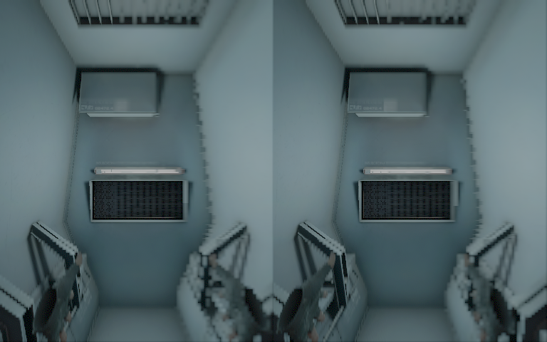
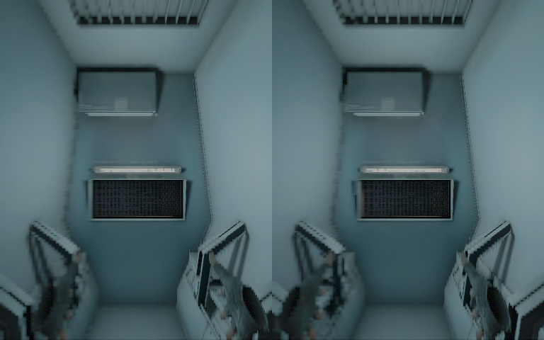
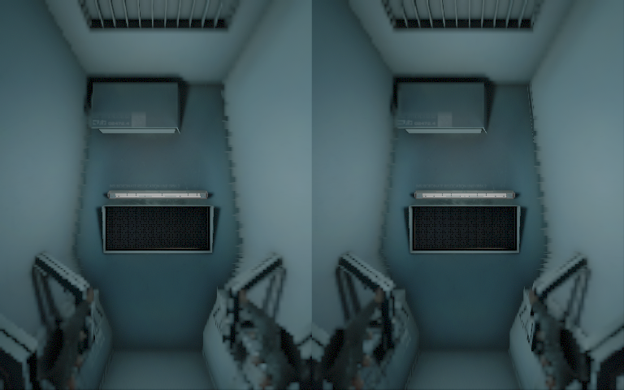

<!-- Copyright 2026, Nick Kennedy; SPDX-License-Identifier: BSL-1.0 -->
# Alyx FDM on KosmicKrisp, stage 2b: PSVR2 headset — 21 October 2026

**Result:** native Half-Life: Alyx runs on the PSVR2 with rate-mapped FDM
(`MESA_KK_EXPERIMENTAL=fdm,fdm_rate`, `+vr_fdm 1 +vr_render_subsampled_depth 1`).
Every FDM pass is shaded through a Metal rasterization rate map, and the user
confirmed the picture is correct with auto fidelity on. The frame rate is still
far too low, at 4–12 fps. FDM does not change it measurably, so fragment shading
in FDM passes is not the limit. This follows the
[stage 2 design and 2a results](macos-alyx-kosmickrisp-fdm-stage2-design.md).

These are the first runs of macOS xrizer on a real headset. Two problems not
related to FDM came up first and are recorded below.

## Headset launcher

`experiments/alyx-vulkan/kosmickrisp-fdm/headset/run-alyx-kk-headset` (copied
from `kk-tests/`) uses the guarded Monado build (`build/monado-kk-fd-guard`) as a
temporary launchd service. It differs from the desktop launchers in four ways:

- **Device:** no simulated device, desktop window or QWERTY input.
- **PSVR2 setup:** the PSVR2 environment (6DoF calibration, camera streams, floor
  height) comes from the installed service's LaunchAgent.
- **Safety check:** it refuses to start if another `monado-service` is running.
- **Alyx option:** it adds `+vr_symmetric_fov 0` (see below).

Monado selected the PSVR2 at 120 Hz in every run. The PSVR2 OpenXR test app
renders correctly through this service, as it does through the installed one.

## Problems on the headset not related to FDM

- **Cut and misaligned eyes:** with Alyx's default `vr_symmetric_fov`, each eye
  showed a hard vertical edge and the eyes did not line up. This happened on
  MoltenVK and KosmicKrisp, with in-process and service compositing, with FDM
  off and without the hidden-area stencil. The PSVR2 FOV is asymmetric (left eye
  −61.5° to +43.5°, ±53°). Native Alyx renders a symmetric FOV, but xrizer submits
  full texture bounds with the asymmetric FOV. `+vr_symmetric_fov 0` fixes it.
  xrizer works with Windows Alyx under Wine, so that path must handle symmetric
  FOV differently; this was not investigated further.
- **Wrong fidelity table:** Alyx loads `vr_fidelity_levels_deckard.csv`, so even
  level 0 is 2112×2208 to 3360×3360 per eye. That is about 10 times the desktop's
  672×768.

## FDM problems found on the headset

Mesa commit `22b4fc7` on `claude/kk-fdm-stage1`
([patch 0005](../experiments/alyx-vulkan/kosmickrisp-fdm/mesa-patches)):

| Symptom | Cause | Fix |
|---|---|---|
| All passes at full rate | Depth not subsampled | `+vr_render_subsampled_depth 1` |
| Crash in `mtl_render_pass_descriptor_set_rate_map` | Two recording threads rebuilt the same map, and one released it while the other set it | Lock around map creation and use; rebuild only when the density data changes |
| World warps as you look (menu fine) | Several layout and timing bugs, below | Below |

Alyx's headset passes use dynamic resolution. Render areas from 2112×2208 to
3360×3360 sit in 3360×3427 attachments (4× MSAA), or in 2184×2227 attachments
(2× MSAA) whose colour resolves into the 3360×3427 image. Alyx sizes its density
maps to the render area, with 32 px texels and a fresh map for each fidelity
level. It reads depth through single-layer views of each eye, and multisampled
depth with `texelFetch`.

The warping had four driver causes. All four now have a rate-probe mode that
fails without the fix and passes with it:

| Cause | Fix | Probe mode |
|---|---|---|
| Map stretched over the attachment instead of 32 px per density texel | Lay out the map in density texels; extend the edge texels | `--area` |
| Per-image parameter block rewritten on the CPU at record time, so frames already recorded decoded with the next fidelity level's map | One parameter block per map version; GPU copy into the image's block before its render pass | `--switch` |
| Sampler mapping used the map's screen size, not the image's | Image size in the sampled-image descriptor | `--mixed` |
| Layer taken from the coordinate only, and `texelFetch` reads not mapped | View base layer in the descriptor; map `txf`/`txf_ms` (not input attachments) | `--eye-maps --views`, `--eye-maps --fetch` |

Headset A/B runs isolated the switching cause: full-rate `fdm` showed no warping,
and neither did `fdm_rate` at a fixed fidelity level. The other fixes also apply
to Alyx's paths, although the density layers turned out identical for both eyes.

Known limitation: the last pixel row or column of a render area can read an
unshaded physical pixel, where a coarse pixel straddles the edge. In Alyx this
is the outer image edge.

## Verification

- **Rate probe** ([rate-probe](../experiments/alyx-vulkan/kosmickrisp-fdm/rate-probe),
  `build.sh OUT`): every mode passes with `fdm,fdm_rate` under Metal API
  validation. That includes `--custom-resolve --samples4 --area --fetch --switch`
  and `--mixed --area`, with exact centres and peripheral error ≤ 2.24 px. Fragment
  work is 34.8% of full rate for the whole target, and 36% of the rendered area
  with `--area`.
- **Regression:** the stage 1 FDM probe, the custom resolve probe and the Metal
  interop test pass with no flags, `fdm` and `fdm,fdm_rate`.
- **Headset:** `runs/claude-headset-fdm-rate-auto-2`: every FDM pass rate mapped,
  no faults, picture confirmed correct by the user.

## Frame rate

| Run, 30 s windows | 0–30 s | 60–90 s | 150–180 s |
|---|---|---|---|
| FDM off (`claude-headset-asymfov-1`) | 8.4 fps, GPU 55 ms | 8.6 fps, 92 ms | 4.2 fps, 155 ms |
| Rate-mapped FDM (`claude-headset-fdm-rate-auto-2`) | 9.4 fps, 62 ms | 9.0 fps, 93 ms | 3.8 fps, 149 ms |

The routines differ and auto fidelity is active, so this is not a controlled
comparison. Still, both runs slow down steadily over three minutes, and FDM makes
no visible difference, so the limit is elsewhere. After the runs, swap was at 6.7
of 7 GB on a 24 GB machine, and no thermal warnings were recorded. The 4× MSAA
targets are very large and fully backed, because custom resolve reads them back.
Next steps:

- Track memory and swap during a run.
- Find which passes take the GPU time.
- Run a controlled FDM on/off comparison at a fixed fidelity level and a lower
  render size.

## Frame-rate investigation — 22 October 2026

Tools are in [`kosmickrisp-fdm/perf`](../experiments/alyx-vulkan/kosmickrisp-fdm/perf).
`memsample.py` samples free, wired and compressed memory, pageouts, swap, the
GPU driver's `PerformanceStatistics` (allocated and in-use memory, utilisation,
split scenes) and Alyx's footprint every 2 s. `headset-profile-run` adds that,
plus optional Metal System Traces, to a headset run. Mesa `e9a3c7e` (patch 0006)
adds `KK_LABEL_PASSES`, `KK_ENCODER_STATS` and logging of Metal command queue
errors.

### With Alyx's Deckard fidelity table

Alyx loads `vr_fidelity_levels_deckard.csv`. On the PSVR2 it renders 2184×2227
(2× MSAA) to 3360×3427 (4× MSAA) per eye, and is GPU bound at about 95%.

| Time | Free | Compressed | Pageouts | GPU allocated | Alyx footprint | GPU busy |
|---|---|---|---|---|---|---|
| 8 s | 1.8 GB | 1.5 GB | 366k | 6.1 GB | 5.4 GB | 99% |
| 34 s | 78 MB | 1.4 GB | 366k | 7.1 GB | 6.3 GB | 97% |
| 63 s | 47 MB | 6.7 GB | 485k | 8.1 GB | 10.2 GB | 81% |

The 24 GB machine runs out of memory and pages. Both profiled runs then crashed
with `MTL_COMMAND_QUEUE_ERROR_TIMEOUT` (device lost; xrizer panics afterwards).
Even at level 0, GPU time was 130–140 ms per frame.

A Metal trace of Alyx's process put compute at 79% of its GPU time, fragment at
16% and vertex at 5%, which is why FDM made no difference there. No compute
encoder ended a render pass. Most compute encoders come from KK's built-in
kernels (query reset and copy, predicated draws) and from copies; Alyx's own
dispatches are rare. In a desktop trace the built-in kernels averaged about
0.4 ms each, and every KK encoder ends with a full GPU barrier. Instruments did
not associate most render-pass intervals with their labels, so a complete
per-pass breakdown was not possible.

### With a low-resolution override table

Alyx reads `game/hlvr/vr_fidelity_levels_override.csv` when it exists. The
[override used](../experiments/alyx-vulkan/kosmickrisp-fdm/perf/vr_fidelity_levels_override.csv)
has scales 0.25–0.6 and 2× MSAA. These are paired unattended 300 s runs on the
static menu: fixed level 5 (1344×1344 render area in 1680×1713 targets),
`XRT_MACOS_EXIT_ON_DISPLAY_LOSS=0`, with
`claude-headset-lowres-off-2` (`+vr_fdm 0`) against `claude-headset-lowres-fdm-2`
(`fdm,fdm_rate`, `+vr_fdm 1 +vr_render_subsampled_depth 1`).

| Steady 40–290 s | FDM off | Rate-mapped FDM |
|---|---:|---:|
| Frame rate | 29.9 fps | 33.7 fps |
| GPU time, median / p90 | 25.7 / 32.3 ms | **19.1** / 26.7 ms |
| Frame interval, median / p99 | 33.3 / 52.2 ms | 31.2 / 50.5 ms |
| Alyx footprint / GPU allocation | 4.4 / 4.6 GB | 4.5 / 4.7 GB |
| Paging, swap growth | none | none |

All 53,248 FDM passes were rate mapped. FDM cuts median GPU time by 26%. In both
runs GPU time on the static scene rises over the first three minutes (20 to
29 ms off, 16 to 24 ms on), possibly thermal throttling on this fanless machine;
this was not confirmed. The frame interval is about 4× the 8.33 ms display period.

Unattended runs need `XRT_MACOS_EXIT_ON_DISPLAY_LOSS=0`: with nobody wearing it,
the PSVR2 display turns off, and the service otherwise exits. The headset wrapper
now lets environment variables override the LaunchAgent's PSVR2 settings.

## Encoder overhead and in-pass resolve — 22 October 2026

### Barriers between encoders (Mesa `4563150`, patch 0007)

Alyx records about 160 render passes per frame and a pipeline barrier between
almost every pair (721,950 barriers for 727,011 render passes in a desktop run).
KK ended every encoder with a barrier on all stages and dropped barriers recorded
between encoders. Nearly all of Alyx's barriers are one of two kinds: attachment
and transfer writes (`0x1600`/`0x1500`) before tests, colour output, compute and
transfer (`0x1f00`), with the vertex shader added in about half (`0x1f08`). So the
next pass's vertex work need not wait for the previous pass's fragment work.

`MESA_KK_EXPERIMENTAL=light_barriers`:

- Converts barriers recorded between encoders to Metal stages.
- Applies them at the start of the next render encoder, with no barrier at
  encoder end.
- Keeps full barriers for compute encoders, the start of each command buffer,
  render-pass restarts and splits, resumed passes and the custom-resolve switch.
- Makes `vkCmdWaitEvents2` apply its dependencies.

All probes pass with it. On the desktop menu (`claude-barrier-ab-*-1`, level 5,
FDM on), median GPU time falls from 10.98 to 8.21 ms (p90 from 12.33 to
10.74 ms). It has not yet been checked visually on the headset.

### Custom resolve in tile memory (experiment)

[`tile-resolve/tile_resolve.m`](../experiments/alyx-vulkan/kosmickrisp-fdm/tile-resolve/tile_resolve.m)
renders a 2-layer MSAA target and resolves it in the same render pass with a tile
function. The function reads every sample from the implicit imageblock, gets the
layer from `[[render_target_array_index]]` and writes a texture array. It matches
a two-pass resolve; 4× MSAA needs 16×16 tiles.

| Size, MSAA | Tile resolve, memoryless | Store + resolve pass (KK today) | MSAA memory |
|---|---:|---:|---:|
| 1680×1713×2, 2× | 1.29 ms | 1.14 ms | 90 MB |
| same, rate map | 0.62 ms | 1.04 ms | 90 MB |
| 1680×1713×2, 4× | 0.77 ms | 2.47 ms | 180 MB |
| 3360×3427×2, 4× | 1.56 ms | 8.89 ms | 710 MB |
| same, rate map | 0.61 ms | 3.61 ms | 710 MB |

With a rate map, the last physical row is not covered by the two-pass reference;
those rows are excluded from the comparison.

`KK_SEQ_LOG=1` (Mesa `3d34c42`, patch 0008) shows that this does not carry over
directly to Alyx. Each stereo FDM pass is recorded as three command buffers using
suspend and resume (rendering flags `0x82`, `0x86`, `0x84`), and the custom-resolve
stage is in the last one. The middle segment also contains a `BY_REGION`
colour-attachment-write to input-attachment-read barrier, which KK splits because
the pass is multisampled. Tile memory cannot survive a Metal command-buffer
boundary or a split, so the MSAA images must stay backed. They are stored and
reloaded at every boundary.

Memoryless MSAA would need suspended and resumed passes merged across command
buffers. A tile resolve in the last segment alone would save one MSAA store and
reload per frame, about 0.4 ms at the current settings, but no memory.

## Custom resolve in tile memory and stitched passes — 22 October 2026

Mesa `4cc6e6a` ([patch 0009](../experiments/alyx-vulkan/kosmickrisp-fdm/mesa-patches)),
both opt-in and work in progress.

### Alyx's multisampled FDM pass

`KK_SEQ_LOG` shows each stereo pass as three command buffers joined with suspend
and resume. The rendering flags include custom resolve: `0x82`, `0x86`, then
`0x84`. The colour target and depth are 2× MSAA, transient, cleared on load and
don't-care on store. The colour resolve is custom; depth and stencil use
`SAMPLE_ZERO`, which KK does with a meta pass after the render pass. Alyx's colour
resolve shader is brightness-weighted: each sample is weighted by 1/(1+max(rgb)).

The final segment contains:

- a by-region barrier
- a 4-vertex draw that reads the MSAA colour as an input attachment
- a second by-region barrier
- the custom resolve

KK splits the pass at the first barrier. KK also forces stores and loads at every
segment boundary. With multiview it treats even full-area passes as partial: it
compares the view mask with `layerCount`, which Vulkan ignores for multiview.

### `tile_resolve`

Custom-resolve fragment shaders that read only colour input attachments get a
Metal tile-function variant:

- Input attachment reads become imageblock sample reads.
- Colour outputs become texture writes to the resolve images. Their storage
  handles are in a new root-table field, `custom_resolve_outputs`.
- The layer comes from `[[render_target_array_index]]`.

Tile pipelines are built per pass sample count on first use, because a resolve
pipeline doesn't know the MSAA sample count. In the final segment, the custom
resolve becomes a tile dispatch in the same render pass, using 32×32 tiles at 2×
and 16×16 at 4×. A by-region fragment barrier there is deferred, then split if a
draw follows, or dropped if the resolve follows. Alyx's resolve shader qualifies,
and Alyx renders correctly with it.

On the desktop, ten alternating runs show no measurable change in GPU time
(12.25 against 12.35 ms on average). MSAA is still stored and reloaded at the
segment boundaries.

### Metal 4 suspend and resume

[`stitch_resolve.m`](../experiments/alyx-vulkan/kosmickrisp-fdm/tile-resolve/stitch_resolve.m)
shows that a pass split across three MTL4 command buffers can keep a memoryless
MSAA target in tile memory. It uses `MTL4RenderEncoderOptionSuspending` and
`MTL4RenderEncoderOptionResuming`, and one `commit:count:`. The tile resolve in
the last command buffer then sees all three segments. This holds at 2× and 4×,
at up to 3360×3427 per eye, and with a rate map.

Undocumented constraints found:

- The segments' render pass descriptors must be equal, including load actions
  and tile size.
- Passes with a visibility buffer must use `MTLVisibilityResultTypeAccumulate`.
- Any encoder after the resumed pass in the last command buffer silently breaks
  the result. Encoders before the suspending pass, and separate commits after,
  are fine.

### `stitch_passes`

KK creates suspending and resuming render encoders from the Vulkan flags and
uses accumulating visibility. Equal descriptors are kept by not forcing load on
resumed segments. Suspending encoders don't store.

Submission changes too:

- The joined command buffers are committed together.
- The Metal command buffer is ended after a final resumed pass, and the rest of
  that Vulkan command buffer is committed separately.
- Command buffers submitted between segments, which Vulkan allows when they
  contain no action commands, are committed after the chain.

The custom resolve probe passes in all variants, with and without `tile_resolve`
and `light_barriers`. The fill drawn in segment 0 reaches the resolve only
through tile memory.

Without the deferral, Apple's driver crashed in `mergeRenderEncoders` when an
unrelated command buffer fell inside a chain.

### The `stitch_passes` GPU timeout (Mesa `cfda5f5`, patch 0010)

With the deferral, Alyx hit `MTL_COMMAND_QUEUE_ERROR_TIMEOUT` on its first
stitched chain. Metal validation reported nothing. Bisecting inside KK, with the
probes in
[`tile-resolve/`](../experiments/alyx-vulkan/kosmickrisp-fdm/tile-resolve/):

| Change | Timeout? |
| --- | --- |
| Stitch only the shadow-atlas passes (depth-only, 1×) | yes |
| Stitch only the MSAA eye pass | yes |
| Drop all draws in stitched passes | no |
| Drop only indexed draws | no |
| Drop only indexed draws in the first segment | later, after ~180 commits |
| Queue drains on the CPU before each stitched commit | yes |
| GPU-side queue wait after each stitched commit | yes |
| CPU waits for each stitched commit to finish | no |
| 30 ms CPU sleep after each stitched commit | no |
| Stitched command allocators kept out of the pool | no |

KK returns a command buffer's `MTL4CommandAllocator` to the pool when recording
ends, before the buffer is committed. The next recording then appends to the
same allocator. For ordinary buffers that is fine. For a suspended render
encoder, it races with the driver's merge of the stitched pass, and the GPU
hangs. Anything that slows the CPU after the commit hides it, and fewer commands
make it rarer.

The fix holds the allocators of stitched command buffers until their commit
completes, then returns them to a device-wide list. That alone ran to commit
~27,900. The one remaining timeout was a chain with a barrier split inside a
middle segment, which Metal cannot express. KK now gathers each chain at submit
and re-records chains that break the rules, or are left open at the end of a
submission, without stitching.

Result, desktop, fidelity 5, FDM off, 60 s runs: no timeouts. 5,868 chains were
stitched and 15 re-recorded. GPU time per frame, median of three runs each:

| Configuration | GPU median | p90 |
| --- | --- | --- |
| Stitching off | 13.53 ms | 16.40 ms |
| `stitch_passes` | 13.89 ms | 16.48 ms |

Stitching alone costs about 3%. It is only the enabler for memoryless MSAA.

The shadow probe, `shadow_stitch.m`, did not reproduce the hang. It has no
concurrent recording.

### Left eye losing later segments (Mesa `5476876`, patch 0011)

On the headset, the menu and hands flickered out of the left eye while the
background stayed. The right eye was correct. The background is drawn in the
first segment of the 4-segment eye pass. The menu and hands are drawn in later
segments. There were no queue errors.

The final segment ends in a split. The rest of that Vulkan command buffer,
including the custom resolve and the per-layer depth resolves, is committed after
the stitched group. Metal could start it before the merged pass had stored its
attachments, so the resolve read a stale copy. The queue now signals a shared
event after the stitched group and waits on it before the tail commit. With
that, the user saw the left eye steady in the desktop preview.
`KK_STITCH_LOG=N` logs the encoders of the first N stitched chains.

Desktop timing with the wait, same settings, three runs each, after the laptop
went on a fan stand:

| Configuration | GPU median | p90 |
| --- | --- | --- |
| Stitching off | 11.74 ms | 13.39 ms |
| `stitch_passes` | 11.58 ms | 12.53 ms |

All six runs held 60 fps. The difference is within noise. The fan stand
explains the lower times than the earlier table.

On the headset the user saw both eyes steady. That attended run ran at 2.6 fps,
with frames 383 ms apart, but the cause was not found. Unattended runs straight
after did not repeat it. FDM off, fidelity 5, `+vr_render_subsampled_depth 1`,
150 s each:

| Configuration | fps | GPU median | Frame interval |
| --- | --- | --- | --- |
| Stitching off | 23.7 | 31.7 ms | 42.6 ms |
| `stitch_passes`, no tail wait | 20.5 | 39.9 ms | 47.1 ms |
| `stitch_passes`, tail wait on a plain `MTLEvent` | 17.2 | 47.0 ms | 57.5 ms |
| `stitch_passes`, tail wait on a shared event (as committed) | 22.9 | 32.2 ms | 46.9 ms |
| `stitch_passes`, tail wait on a shared event, rerun | 25.3 | 30.8 ms | 37.7 ms |

Stitching does not cost frame rate on the headset. These runs are below the
earlier 30–33 fps without FDM, which did not use
`+vr_render_subsampled_depth 1`.

### All experiments together on the headset

`MESA_KK_EXPERIMENTAL=fdm,fdm_rate,light_barriers,tile_resolve,stitch_passes`,
`+vr_fdm 1`, fidelity 5. Attended.

- **Image:** the user saw correct rendering from the menu into
  `a1_intro_world_2`, as far as the hidden door in the lockers.
- **Driver:** no queue errors. 2,468 chains were stitched and 16 re-recorded,
  all at startup.
- **Timing:** median frame interval 40.7 ms, GPU median 31.4 ms (p90 41.4 ms).
- **Stalls:** after the lockers, frames stopped for 1–5 s at a time, from
  88 s to 103 s. The 14 s gap at 74 s is the map load.

The stalls look like first-time pipeline compilation. With `tile_resolve`, the
tile pipelines are also built at first draw, on the render thread. A second pass
through the same area would tell. The run ended at 114 s because
`launch_xrizer.py` defaults to `--timeout 120`. The earlier headset runs that
ended with exit 124 hit the same limit.

### Memoryless targets and stitching

`stitch_resolve.m` with `HEAVY=` draws many small triangles in each segment:

| Target | Triangles | Result |
| --- | --- | --- |
| Memoryless, not stitched | 60M in one pass | OK |
| Memoryless, stitched, 3 segments | 12M per segment | OK |
| Memoryless, stitched, 3 segments | 15M per segment | queue error 1 after ~290 ms |
| Private with load and store, stitched | 60M per segment | OK |

A stitched pass on a memoryless target fails once it has enough geometry. A
single pass doesn't. Alyx's passes are far below that, but the limit needs
watching once MSAA is memoryless.

## Keeping the eye pass in tile memory — 22 October 2026

The headset was not available, so this work used unattended desktop runs.

### Unattended gameplay runs

[`desktop/run-alyx-desktop-game`](../experiments/alyx-vulkan/kosmickrisp-fdm/desktop/run-alyx-desktop-game)
loads `a1_intro_world_2` with `-novid` against a simulated headset. Alyx waits
for a controller press before rendering the map, so Monado's qwerty driver
gained `QWERTY_SCRIPT`, timed scripted key and button input (Monado
`c8a8910ec`, branch `claude/qwerty-scripted-input`). The script clicks the left
controller's trigger every 15 s from 45 s, as Left Ctrl + click does by hand.
That Monado build has libusb and the Rift driver off, so a wedged PS VR2
adapter cannot block its startup. A separate game temp folder avoids the
single-instance lock of a stuck earlier `alyx_host`.

`KK_DUMP_RESOLVE_DIR` saves the custom-resolve colour and the resolved depth of
selected passes. [`desktop/kkdump.py`](../experiments/alyx-vulkan/kosmickrisp-fdm/desktop/kkdump.py)
converts them to PNG and compares runs. The simulated head is still, so the
same pass in two runs shows the same view. `KK_SEQ_LOG` with `KK_SEQ_MSL_DIR`
saves the fragment shaders of a logged pass.

### What the final segment does in gameplay

| Step | What it is |
| --- | --- |
| By-region barrier | colour attachment write → input attachment read |
| 4-vertex draw | reads sample 0 of the MSAA colour as an input attachment, discards by luminance; colour write mask 0, no depth or stencil test |
| By-region barrier | colour and depth write → fragment read |
| Custom resolve | brightness-weighted colour resolve |

The draw only feeds occlusion queries. It looks like Source 2's exposure
histogram. In the menu scene it is absent.

### Dynamic colour write masks (Mesa `999b131`, patch 0012)

KK ignored dynamic colour write masks. It blends in the shader using the
pipeline's static masks, and its Metal pipelines always write every channel.
Most of Alyx's pipelines set the mask dynamically, the luminance draw among
them. The custom-resolve probe's `--ia-dyn-mask` shows the bug with every
experiment off. Pipelines with dynamic masks now get Metal pipeline variants
with matching `writeMask` values, built on first use.

### `ms_input_fetch` (same commit)

Metal does not allow imageblocks in fragment functions, so a pixel-rate
fragment shader cannot read sample 0 from tile memory
([`fragment_imageblock.m`](../experiments/alyx-vulkan/kosmickrisp-fdm/tile-resolve/fragment_imageblock.m)).
Reading `[[color(0)]]` on an MSAA target makes Metal run the shader once per
sample, each invocation seeing its own sample, on private and memoryless
targets.

`ms_input_fetch` lowers multisampled colour input-attachment reads in shaders
other than custom-resolve shaders to framebuffer fetches. The deferred barrier
then no longer splits the final segment, as long as the draw's fragment shader
reads no multisampled texture. Samples other than 0 now test their own
luminance. That only changes the histogram's counts at edges.

Without the write-mask fix, the luminance draw's output reached the left eye
as white patches. With it, eye images match the baseline.

### `ds_resolve` (Mesa `cd25a61`, patch 0013)

`ds_resolve` resolves depth and stencil in stitched passes with Metal's
`SAMPLE_ZERO` resolve instead of meta passes afterwards. Two Metal behaviours
showed up with a render target smaller than the attachment
([`depth_resolve_area.m`](../experiments/alyx-vulkan/kosmickrisp-fdm/tile-resolve/depth_resolve_area.m)):

| Store action | Inside the area | Outside the area | Second layer |
| --- | --- | --- | --- |
| Multisample resolve | resolved | resolve texture rewritten | resolved |
| Store and multisample resolve | resolved | resolve texture rewritten | not resolved |

KK forces a store for partial areas, so at first the right eye's resolved
depth stayed empty. Don't-care depth and stencil resolved in the pass are no
longer force-stored at the end of the pass. Metal still rewrites the
depth-resolve image outside the render area. Alyx draws only inside it.

The queue wait after stitched passes orders the resolve before later work. KK
avoided render-pass depth resolves because of exactly that ordering problem.
The resolve texture is set in every segment, so the descriptors stay equal. The
legacy custom resolve path reads the MSAA depth, so it still stores and
resolves afterwards.

Resolved depth matches KK's meta resolve exactly in both eyes. With
`ms_input_fetch` and `ds_resolve`, the eye pass's final segment is a single
render encoder.

### Desktop gameplay timing

`a1_intro_world_2`, fidelity 5, FDM off, frames from 100 s to 195 s, two runs
each:

| Configuration | GPU median | p90 |
| --- | --- | --- |
| No experiments | 6.83 ms | 8.65 ms |
| `stitch_passes` | 6.77 ms | 8.65 ms |
| `tile_resolve,ms_input_fetch,stitch_passes,ds_resolve` | 6.67 ms | 8.49 ms |
| The same plus `light_barriers` | 6.77 ms | 8.57 ms |

All runs held 60 fps. The full set is about 2% faster. The scene is light, so
the headset is where this matters.

### Memoryless MSAA: not possible for Alyx's images

Alyx creates its MSAA images without `TRANSIENT_ATTACHMENT`, with sampled and
transfer usage (colour `0x97`, depth `0xa7`), and does not bind them to the
lazily allocated memory type. Vulkan gives KK no permission to make them
memoryless. With everything in tile memory, memoryless would only save memory:
the passes already neither load nor store the MSAA data.

### Still to do

- **Headset:** run the full set, with and without FDM.
- **Fallback:** 16 chains at startup are still re-recorded without stitching.

## Gaze-centred FDM in KosmicKrisp — 22 October 2026

Alyx draws its density map itself and gets no gaze through OpenVR. Monado's
eye-tracked foveation (`XR_META_foveation_eye_tracked`) needs a foveation
profile on a swapchain, and Monado rejects that for Vulkan swapchains such as
xrizer's. So gaze has to reach KK from xrizer, which can read it through
`XR_EXT_eye_gaze_interaction`. Alyx removes the foveation itself before
submitting, so the compositor is not involved.

### KK side (Mesa `325c97a`, patch 0014)

- `kk_fdm_set_gaze(view, x, y, valid)` is exported from the driver library.
  `x` and `y` are in [0, 1] across the render area. `KK_FDM_GAZE` simulates gaze
  as `x,y` or `sweep[:seconds]`.
- Gaze is latched at queue submission, at most every 10 ms, so the passes of a
  frame share one map.
- KK keeps the column and row rate profiles it derives from Alyx's density map,
  and shifts them per eye so that the middle of the highest-rate band lands on
  the gaze point. Rate maps stay separable, so the high-rate region is still a
  cross.
- Rate-map parameter blocks (64 KB each) were kept until the density image was
  destroyed. They are now recycled through a ring of eight per density image.
- A stitched chain whose segments got different maps is re-recorded without
  stitching under one latched gaze.

### Desktop results

`a1_intro_world_2`, `+vr_fdm 1`, fidelity 5, final 8-bit eye image
(`KK_DUMP_PASSES_DIR`). Left, gaze fixed at (0.2, 0.5): the left wall and
railing stay sharp and the right side is blocky. Right, gaze at (0.8, 0.5): the
reverse.

| Run | Maps built | Stitch fallbacks | Queue errors |
| --- | --- | --- | --- |
| `fdm,fdm_rate`, gaze sweep every 4 s | over 2,000 | — | 0 |
| Full set, gaze sweep | over 1,000 | 128 of about 5,400 (16 at startup) | 0 |

All runs held 60 fps. Frames from the sweep show no seams or corruption.

### xrizer side (branch `claude/xrizer-gaze`, `a0677f6`)

The worktree is `workspace/xrizer-claude-gaze`, branched from the
`xrizer-performance` commit the launcher builds (`34cad59`). Build it into
`build/xrizer-gaze`.

- With `XRIZER_FDM_GAZE=1`, xrizer enables `XR_EXT_eye_gaze_interaction` if the
  runtime offers it, and adds an eye gaze pose action to its pose action set.
  That set is attached and synced with Alyx's action sets.
- After each `xrWaitFrame`, xrizer locates the gaze relative to the head and
  projects its direction into each view's field of view, which handles the PS
  VR2's asymmetric FOV. It then calls `kk_fdm_set_gaze`. The Vulkan loader opens
  KK privately, so xrizer finds it by image name among the loaded libraries.
- Untracked gaze turns the shift off.
- `XRIZER_FAKE_GAZE=yaw,pitch` fakes the direction, and `XRIZER_FDM_GAZE_LOG`
  logs the points.
- `XRIZER_LIBRARY` makes `run-alyx-kk-headset` and `run-alyx-desktop-game` use
  this build.

Desktop results, simulated headset:

| Run | Gaze points | Map shift | Queue errors |
| --- | --- | --- | --- |
| `XRIZER_FAKE_GAZE=-20,0` | (0.30, 0.5) both eyes | −5 half-texels both eyes | 0 |
| `XRIZER_FDM_GAZE=1`, no eye tracker | none | 0 | 0 |

With faked gaze, the final image is sharp on the left and blocky on the right in
both eyes. Monado reports `ext_eye_gaze_interaction_enabled: true`, and the
scripted controller input still works with the extra action.

### Headset run with real gaze

`fdm,fdm_rate`, `XRIZER_FDM_GAZE=1`, fidelity 5, attended. The user reported that
foveation followed gaze well.

- **Gaze:** invalid for the first few seconds, then valid. Looking ahead gives
  about (0.65, 0.5) in the left eye and (0.33, 0.5) in the right, the optical
  centres of the PS VR2's asymmetric views. Both maps followed.
- **Alyx's own map:** it is centred on the middle of each image, not the lens
  axis, so gaze centring also moves full rate to where the user is looking when
  they look ahead.
- **Calibration:** the user calibration in `~/Library/Application
  Support/monado/psvr2/gaze_user_calibration.txt` is read by the driver and only
  logged at debug level. The "No PS VR2 eye calibration blob found" warning
  concerns Sony's factory blob.

The game froze for 5.3 s just after teleporting in the van, then crashed. The
in-process compositor waits at most `XRT_MACOS_CLIENT_GPU_HUNG_MS` (5000 ms) for
a submitted frame's GPU work. It logged `Client GPU obligation failed`, lost the
session, and xrizer panicked on `XR_ERROR_INSTANCE_LOST` from `xrEndFrame`. The
earlier combined run's longest freeze, 4.8 s, was just under the limit. Both
came on entering a new area, which points to pipeline compilation, not gaze.
`run-alyx-kk-headset` now sets `XRT_MACOS_CLIENT_GPU_HUNG_MS=30000`.

### Still to do

- **Freezes:** see below.
- **xrizer:** exit cleanly instead of panicking when the session is lost.

## Freezes on entering new areas — 22 October 2026

Mesa `KK_COMPILE_LOG` times compiles per thread. Two identical desktop gameplay
runs (`a1_intro_world_2`, FDM and the full experiment set), straight after
each other:

| | Metal render pipelines over 5 ms | Their total | Frame gaps over 0.4 s after the first frame |
| --- | --- | --- | --- |
| First run | 170 | 32.8 s (up to 0.55 s each) | 2.1, 1.7, 1.4, 1.1, 0.9 s and more |
| Second run | 5 | 0.03 s | one, 0.45 s |

KK's NIR-to-MSL step takes about 1 s in total either way. The cost is Metal
compiling MSL source into a library and pipeline. Alyx creates many pipelines
on worker threads, but some also on the threads that submit frames, and those
compiles freeze the game.

The system Metal shader cache makes the second encounter almost free, and it
survives runs and reboots. It is keyed on the MSL text, so any KK change that
alters generated code, or a different experiment set, makes those shaders cold
again. Today's headset freezes came after such changes.

Options:

- **Warm the cache:** after a KK change, play through with the experiment set
  to be used. A desktop run covers only the start of a map.
- **Binary archives:** store compiled pipelines in an `MTLBinaryArchive`
  controlled by KK, which does not depend on the OS cache.
- **Raised limit:** keep `XRT_MACOS_CLIENT_GPU_HUNG_MS=30000` so a freeze no
  longer ends the session.

### Cold compiles by configuration

`KK_MSL_SALT`, a test aid prepended to every MSL source and not committed, forces
every Metal compile to miss the cache. Same desktop session as above:

| Configuration | Metal pipelines over 5 ms | Their total | Longest |
| --- | --- | --- | --- |
| No experiments | 162 | 26.9 s | 474 ms |
| `fdm,fdm_rate` | 163 | 27.9 s | 506 ms |

The experiments do not add compile work. The write-mask variants, about 1.8 s,
appear in both because that fix applies everywhere. Rebuilding KK without
changing generated code keeps the cache warm: a rebuild with a new library UUID
gave 0.01 s. A cold run straight after the FDM-only runs may come from the
shared system cache evicting entries.

The two macOS panics that day (SOCD, iBoot) did not come during compile floods.
At 11:30 nothing had been running for 30 min. At 14:52 a run had stopped making
progress at startup 8 min earlier, and Monado had logged that the display link
had not fired. `caffeinate` had not been restarted after the first reboot. Since
then, runs go through a watchdog that stops on a stalled log.

## Eye images in the top left with FDM and stitching (Mesa `b9719f1`)

On the desktop, each eye's picture filled only about 56% of its 384×480 area,
in the top left, like FDM's physical layout. The submit bounds (0.8 × 0.8333)
and xrizer's 384×480 swapchain were the same with FDM on and off. Bisecting
pointed to `fdm,fdm_rate,stitch_passes`; `fdm,fdm_rate,tile_resolve` was correct.

Subsampled images got their rate parameters once, by a GPU copy in the first
pass that rendered them, and a CPU-side mark then skipped further copies. The
16 stitched chains that fall back at startup are re-recorded, so the recording
holding that copy was never submitted and the image kept empty parameters. KK
now copies the parameters, sized to the header and the map's data, in every
pass that renders the image and does not resume a stitched pass. With all
experiments and FDM on, the final eye images fill their area again, with no
new fallbacks and no queue errors.

## Background pipeline builds (Mesa `bb5772b`, patch 0017)

`MESA_KK_EXPERIMENTAL=async_pipelines` returns from graphics pipeline creation
once the MSL exists, and builds the Metal render pipeline on a device thread
pool, up to 8 threads.

- **Draws:** a draw whose pipeline is still being built waits up to
  `KK_ASYNC_PIPELINE_WAIT_MS` (2 ms by default) and is then skipped. Objects
  may be missing for a few frames instead of the game freezing. In VR, Monado
  keeps reprojecting meanwhile.
- **Kept synchronous:** compute pipelines, KK's own meta pipelines (marked with
  a thread-local flag in `kk_meta_begin`/`kk_meta_end` and at device setup),
  and the write-mask and tile variants built at draw time.
- **Teardown:** destroying a shader waits for its build.

Desktop gameplay, `fdm,fdm_rate`, every shader forced cold with a test-only salt
on the MSL, frames after load:

| | Freezes over 0.25 s | Their total | Longest | Draws skipped | Frames |
| --- | --- | --- | --- | --- | --- |
| Synchronous | 15 | 8.3 s | 1.73 s | 0 | 6,811 |
| `async_pipelines` | 1 | 0.3 s | 0.25 s | 1,486 | 8,071 |

The skips stopped once all builds finished. A late frame shows the same scene
and objects as the synchronous run.

With a warm cache nothing changes: builds finish within the wait. Untested on
the headset.
